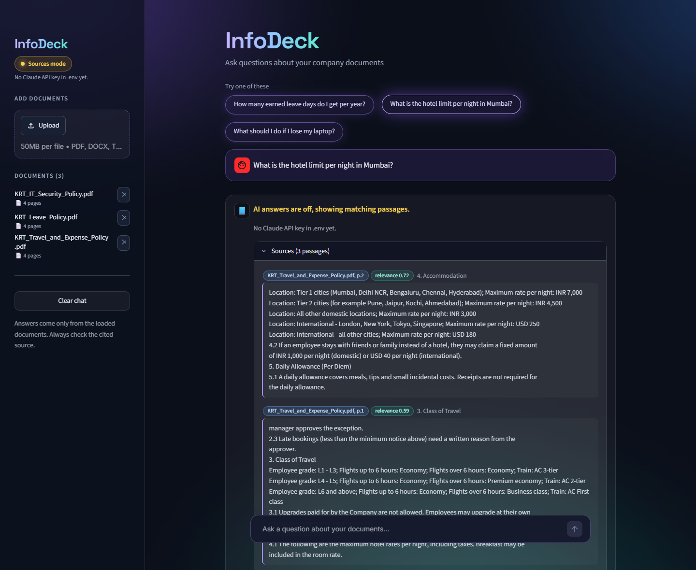

# InfoDeck

**Ask questions about your company documents and get short answers with sources.**

Upload PDFs (text or scanned), Word, Excel, PowerPoint, text files or photos, and ask
questions in plain English, such as *"What is the hotel limit per night in Mumbai?"* or
*"What is the grip stress corresponding to Pd?"*. InfoDeck finds the relevant paragraphs and
answers **only from your documents**. Every answer cites the file and page it came from. If
the documents don't contain the answer, InfoDeck says *"I could not find this in the
documents."* instead of guessing. Values, units and formulas are copied exactly as written,
never calculated or rounded.



> The documents in `data/sample_docs/` belong to a **fictional company** ("Kestrel Ridge
> Technologies Ltd.") and exist only for testing and demos. They are not real policies.

---

## How it works (RAG)

InfoDeck uses **Retrieval-Augmented Generation (RAG)**. It does not send whole documents to
an AI. Instead, it first finds the few paragraphs that matter and sends only those.

```
 INDEXING (once per document)
 any file ─► read page by page ──────► chunks by structure ─► embedding model ─► ChromaDB
             PARSER=local: text, tables,   (items, Q&A, tables,  (local, free)    (on disk)
               local OCR for scans          then size)
             PARSER=gemini: page images        └─► exact values + Q&A pairs ─► fact index
             (saved to storage/parsed/)

 ANSWERING (every question)
 Question ─► matches a stored value / Q&A pair? ─yes─► "Exact value": value, unit, formula, source line
                 │ no
                 ▼
          20 most similar chunks ─► best match too weak? ─► "I could not find this in the documents."
                                            │ no
                                            ▼
                        re-ranker picks the best 5 chunks
                                            │
                       ┌────────────────────┴────────────────────┐
              AI available (Claude / Ollama)               no API key yet
                       │                                         │
       short answer with citations                  "sources mode": shows the
       like [KRT_Leave_Policy.pdf, p.1]             matching passages + file/page
       + "Check this value in the source" if a
         number is not in the passages
```

## Features

- Upload files with the **"+" button** in the chat box or from the sidebar (see
  [Supported files](#supported-files)). Tables are read row by row; scanned pages and photos are
  read with OCR, several pages at once.
- **Background reading:** uploads are read in the background, one file at a time. The sidebar
  shows *Reading file: page X of N*, and you can already ask about the pages that are done.
- **Exact values:** lines such as `(1) Push-up distance, 10.6 mm` or
  `σra = Pd / Pr x σr = 111 N/mm²`, variable lists and Q&A pairs are indexed separately. A
  matching question is answered straight from the document line (pill **Exact value**),
  without the AI, showing value, unit, formula and source.
- **Number check:** every number in an AI answer must appear in the retrieved passages;
  otherwise the answer shows *"Check this value in the source"*.
- Uploading the same file again is detected by its fingerprint (SHA-256 hash), so nothing is duplicated.
- Answers cite **file + page**. A **Sources** panel shows the exact paragraphs that were used.
- **Three AI modes**, chosen in `.env`:
  - Claude API (default)
  - Ollama (free and local)
  - **Sources mode** (no AI): shows the best matching passages. This is used automatically
    when there is no API key, so the app never crashes because a key is missing.
- Works on the office network: colleagues open `http://<laptop-ip>:8501` in their browser.

## Tech stack

| Part | Library | Why |
|---|---|---|
| PDF reading | `pdfplumber`, `pypdfium2` | Text **and tables** page by page; pages rendered as images for OCR / Gemini |
| OCR | `rapidocr` + `onnxruntime` | Reads scanned pages and photos on the laptop (pip only, no system install) |
| Page images (optional) | Gemini (`google-genai`) | `PARSER=gemini`: Gemini reads each page image into Markdown |
| Office files | `python-docx`, `openpyxl`, `python-pptx` | Word, Excel (one sheet = one page), PowerPoint (one slide = one page) |
| Embeddings | `sentence-transformers` + `BAAI/bge-small-en-v1.5` | Small, fast, runs locally on CPU |
| Re-ranking | `cross-encoder/ms-marco-MiniLM-L6-v2` | Re-orders candidates by how well they answer the question |
| Vector store | `ChromaDB` (persistent folder) | Local, no server needed |
| LLM | `anthropic` (Claude, default `claude-sonnet-5-5`), `google-genai` (Gemini) or `ollama` | Answers streamed live; only 5 short passages are sent |
| UI | `Streamlit` | Chat web app; other people on the network can open it |
| Tests | `pytest` | 70 fast tests with the LLM and Gemini mocked: no API key or internet needed |

## Run it on Windows

**First time only** (needs Python 3.11+ and Git):

```powershell
git clone https://github.com/nehemiah2406/infodeck.git
cd infodeck
python -m venv .venv
.venv\Scripts\python -m pip install -r requirements.txt
copy .env.example .env
```

**Start:** double-click **`run.bat`**. The first start takes about a minute while the models
download and load. The window prints two addresses:

- On this laptop: `http://localhost:8501`
- For colleagues on the same network: `http://<this-laptop-ip>:8501`

To let colleagues connect, allow the port in Windows Firewall once. Open PowerShell
**as Administrator** and run:

```powershell
New-NetFirewallRule -DisplayName "InfoDeck (port 8501)" -Direction Inbound -Protocol TCP -LocalPort 8501 -Action Allow -Profile Domain,Private
```

The three sample PDFs load automatically the first time the app starts.

## Add your Claude API key

1. Create a key at <https://console.anthropic.com> (API Keys).
2. Open the file **`.env`** in the project folder and paste the key after the equals sign:
   `ANTHROPIC_API_KEY=your-key-here` (no quotes, no spaces).
3. Save the file and **refresh the browser**. You don't need to restart. The sidebar pill
   changes from *Sources mode* to *Claude*.

`.env` is listed in `.gitignore`, so it is never committed. The app never prints or logs the key.

**Free local alternative:** install [Ollama](https://ollama.com), run `ollama pull llama3.2:3b`,
then set `LLM_PROVIDER=ollama` and `OLLAMA_MODEL=llama3.2:3b` in `.env`.

**Google Gemini:** create a key at <https://aistudio.google.com/apikey>, then set
`LLM_PROVIDER=gemini` and `GEMINI_API_KEY=your-key-here` in `.env`.

## Supported files

| Type | Read as | Pages |
|---|---|---|
| PDF (text) | text and tables (`Header: value; ...` rows) | real page numbers |
| PDF (scanned, with or without a hidden OCR text layer) | OCR of the page image (the hidden layer is ignored) | real page numbers |
| PNG / JPG (photos, screenshots) | OCR | one page, no number |
| Word `.docx` | paragraphs and tables in order | no page numbers |
| Excel `.xlsx` / `.csv` | each row as `Header: value; ...`, with the sheet name | one sheet = one page |
| PowerPoint `.pptx` | text, tables and notes (OCR for picture-only slides) | one slide = one page |
| Text `.txt` | as is (form feeds = page breaks) | no page numbers |

### Reading pages: `PARSER=local` or `PARSER=gemini`

- **`local` (default):** everything stays on this computer. Scanned pages are read with local OCR
  (`rapidocr`). Good for clean scans; it can still misread a character (see Known limits).
  - **Speed:** OCR is ~95% of the upload time, so `OCR_WORKERS` (default 6) worker processes read
    scanned pages at the same time, at `OCR_DPI` (default 200). Keep the laptop **plugged in**:
    on battery Windows slows OCR down 2.5-4x.
  - **Big PDFs:** finished pages become searchable in small batches while the rest is still
    read (the answer then says which document is still loading). Files are read one after
    another. Removing a document that is loading stops it; if the app is closed while reading,
    uploading the same file again continues from the pages already read.
- **`gemini`:** every PDF page and image is rendered at **200 dpi** and only the **image** is sent to
  Gemini (`GEMINI_MODEL`, `GEMINI_API_KEY`), which writes faithful Markdown: tables as tables,
  formulas exactly as printed, numbered items and Q&A pairs kept together, short notes for
  diagrams. The PDF's own text layer is never used, so a bad OCR layer ("I I I" instead of 111)
  cannot leak in. Word, Excel, PowerPoint and text files are still read locally.
  - **Big PDFs (200+ pages):** 4 pages are read in parallel; rate limits (HTTP 429) and temporary
    server errors are retried automatically, waiting as long as Google asks.
  - **Cache:** pages are saved one by one, so re-uploading the same file (same content) does not
    call Gemini again, and an interrupted upload continues where it stopped.
  - **Privacy: `PARSER=gemini` sends page images to Google - only for non-company documents unless approved.**

### Check what was read

Every parsed page is saved as `storage/parsed/<doc_id>/page_N.md` (`page_0.md` for files
without page numbers). `meta.json` in the same folder names the file and the parser. To find a
document's folder in PowerShell:

```powershell
Select-String -Path storage\parsed\*\meta.json -Pattern "My_File.pdf"
Get-Content storage\parsed\<doc_id>\page_3.md -Encoding utf8
```

These files are also the parse cache. Delete a document's folder to force it to be read again
(switching `PARSER` or `GEMINI_MODEL` does this automatically).

## Settings (`.env`)

| Setting | Default | Meaning |
|---|---|---|
| `LLM_PROVIDER` | `anthropic` | `anthropic`, `gemini` or `ollama` |
| `CLAUDE_MODEL` | `claude-sonnet-5-5` | Claude model used for answers |
| `GEMINI_MODEL` | `gemini-3.8-flash` | Gemini model used when `LLM_PROVIDER=gemini` or `PARSER=gemini` |
| `PARSER` | `local` | `local` (text + local OCR) or `gemini` (page images read by Gemini, see above) |
| `OCR_WORKERS` | `6` | Scanned pages OCR'd at the same time (`1` = one by one, no extra processes) |
| `OCR_DPI` | `200` | Page image resolution for local OCR (150 lost accuracy in the evaluation; 300 was not better) |
| `TOP_K` | `5` | Passages used per question |
| `MIN_SCORE` | `0.55` | If the best passage scores lower than this, the answer is "not found" and no AI call is made |
| `FACT_MATCH_SCORE` | `0.80` | A question at least this similar to a stored value name or Q&A question gets an **Exact value** answer without the AI |
| `RERANK_MODEL` | `cross-encoder/ms-marco-MiniLM-L6-v2` | Set to `none` to switch re-ranking off |
| `CHUNK_SIZE` / `CHUNK_OVERLAP` | `800` / `150` | Chunk length and overlap in characters |

## Evaluation

### Exact answers on complex documents

`eval/questions.csv` has 15 questions (`question, expected_answer, file`) about four fictional
engineering documents in `data/eval_docs/` (made by `scripts/make_eval_docs.py`): a **scanned
calculation sheet with a bad hidden OCR layer**, a **table-heavy PDF**, an **Excel workbook** and a
**Q&A Word file**. The script counts answers that contain the expected value exactly as written:

```powershell
.venv\Scripts\python scripts\eval.py                  # uses PARSER and LLM_PROVIDER from .env
.venv\Scripts\python scripts\eval.py --no-llm         # no AI calls at all
.venv\Scripts\python scripts\eval.py --parser gemini  # read the page images with Gemini
```

Results on 2026-10-27 (`PARSER=local`, Gemini `gemini-3.8-flash` for AI answers):

| Run | Score | How the questions were answered |
|---|---|---|
| Default (exact values on) | **14/15 (93%)** | 13 exact-value answers (no AI) + 1 AI answer |
| `--no-llm` (no AI calls at all) | **14/15 (93%)** | 13 exact-value answers + 1 from the shown passages |
| `--no-exact` (retrieval + AI only, `TOP_K=5`) | 14/15 (93%) | 9 AI answers + 5 passages (Gemini returned 503 "busy") + 1 symbol match |

The one miss in every run is a **local OCR error** on the scanned calculation sheet: it read
`A= 1,118,355` as `A= 1,118,35`. The source line shown with the answer contains the same OCR
text, so the app cannot catch this; the document carries a "read with OCR" warning, and the original
scan must be checked. `TOP_K` stays at **5**: raising it to 8 could not be measured fairly because the Gemini free-tier daily quota ran out during the comparison (see
Known limits). The `--parser gemini` run is still to do for the same reason.

### Upload speed (scanned PDFs, `PARSER=local`)

Fictional 20-page scanned PDF, laptop on the charger (i5-1235U, 10 cores), old and new code
measured alternately on 2026-10-27:

| | Before (one page at a time) | After (`OCR_WORKERS=6`, background reading) |
|---|---|---|
| 20 pages | 87-91 s | 52-54 s (56-67 s for the first upload, while the workers start) |
| First answers possible after | the whole file (87-91 s) | 25-34 s |
| 204 pages (estimate) | ~15 min | ~9 min, first answers after ~30 s |

In a cooler run the same PDF took 79 s before and 42 s after. On battery, everything is
2.5-4x slower.

### Retrieval on the policy PDFs

`eval/retrieval_questions.csv` contains 10 questions about the sample PDFs: 6 answerable, 2 worded
differently from the documents, and 2 whose answer is not in the documents. Run the
evaluation with:

```powershell
.venv\Scripts\python eval\run_eval.py
```

| Metric | Result |
|---|---|
| Retrieval hit rate @5 (right file + page in the top 5) | **8/8 (100%)** |
| Right page ranked first (@1) | 6/8 (75%) |
| "Not found" accuracy (questions not in the documents) | 1/2 (50%) |
| Answerable questions wrongly rejected | 0/8 |

The full per-question table and a threshold sweep are in [eval/results.md](eval/results.md).
A higher `MIN_SCORE` would reject the off-topic "guest WiFi password" question, but it would
also reject real questions, so `0.55` was kept. With Claude enabled, the prompt adds a second
"not found" check.

## Tests

```powershell
.venv\Scripts\python -m pytest            # 80 fast tests, LLM and Gemini mocked
.venv\Scripts\python -m pytest -m slow    # 6 tests with the real embedding + re-ranking models
```

The tests cover every file loader, local OCR, Gemini page parsing with a fake client (only
images sent, 429 retry, cache, resume), structure-aware chunking, exact-value extraction and
answers, near-miss questions that must not match, the number check, duplicate uploads, the
"not found" rule, sources mode, LLM error handling and API-key safety, and fast uploads
(parallel OCR gives the same text, one file at a time, no second job for the same file,
questions while loading, stop, resume).

## Project structure

```
app.py                  Streamlit UI (InfoDeck)
run.bat                 Double-click launcher (LAN mode)
src/infodeck/           loaders, ocr (parallel OCR), jobs (background queue), parsing,
                        gemini_parser, chunking, facts, embeddings, store, llm, prompts, engine
scripts/                ingest_docs.py, ask.py (command line), eval.py, make_sample_docs.py,
                        make_eval_docs.py
eval/                   questions.csv (answers), retrieval_questions.csv, run_eval.py, results.md
tests/                  pytest suite
data/sample_docs/       fictional sample PDFs (safe to share)
data/eval_docs/         fictional engineering documents for scripts/eval.py
```

## Known limits

- **Off-topic questions that sound similar can pass the first check.** For example, "guest
  WiFi password" scores close to real IT-policy questions. In sources mode they show
  unrelated passages. With Claude, the prompt answers "not found".
- **The small model can miss unusual wording.** Questions phrased very differently from
  the documents may need rephrasing.
- **Each question is answered on its own.** Follow-up questions don't use earlier chat messages.
- **One shared library.** Everyone on the network sees the same documents and can upload or
  remove them. There is no login.
- **Local OCR can misread a character.** In the evaluation it read `1,118,355` as `1,118,35`.
  OCR'd pages get a warning; use `PARSER=gemini` (if allowed for the document) or check the
  saved page file in `storage/parsed/` for critical values.
- **Uploading a big scan uses most of the CPU.** With `OCR_WORKERS=6` the laptop stays usable,
  but a 200-page scan still takes several minutes (see "Upload speed" below). While a
  document loads, its repeated headers/footers are detected from its first 6 pages only.
- **Exact-value answers are strict on purpose.** Every content word of the question must appear in
  the value's name (or item title / Q&A pair). Differently worded questions fall back to the
  normal AI answer, which is safer than showing the wrong value.
- **Gemini free tier has a daily request limit per model.** When it is used up, AI answers fall
  back to sources mode with a clear message, and `PARSER=gemini` stops with "quota used up for
  today" (pages read so far are kept, so the next upload continues). A 200-page PDF needs 200
  requests, so big documents need a paid key.
- **Documents indexed before this version** have no exact-value index. Remove and re-upload them
  to get exact-value answers.
- Answers have only been tested in sources mode and with a mocked Claude client. Check
  important answers against the cited page.

## Privacy

- Embedding, search and OCR run **locally**. With Claude or Gemini answers, only the question
  and the retrieved passages are sent to the API, never whole documents. With Ollama, nothing
  leaves the laptop.
- **`PARSER=gemini` sends every page image to Google.** Use it only for non-company documents
  unless approved. The default `PARSER=local` sends nothing while reading files.
- Parsed page text is kept in `storage/parsed/` (git-ignored) even after a document is removed, so
  re-uploading it is fast. Delete the folder to remove it completely.
- `.env`, uploaded files (`data/uploads/`), the vector store (`storage/`) and every PDF/Office
  file outside `data/sample_docs/` are git-ignored.
